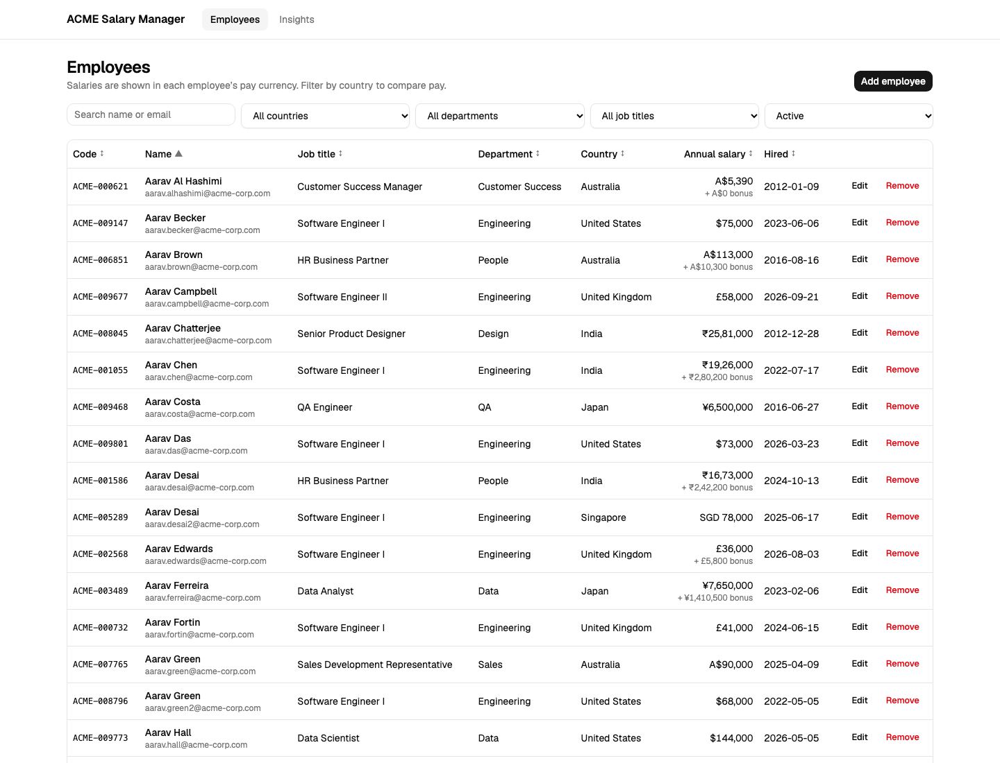
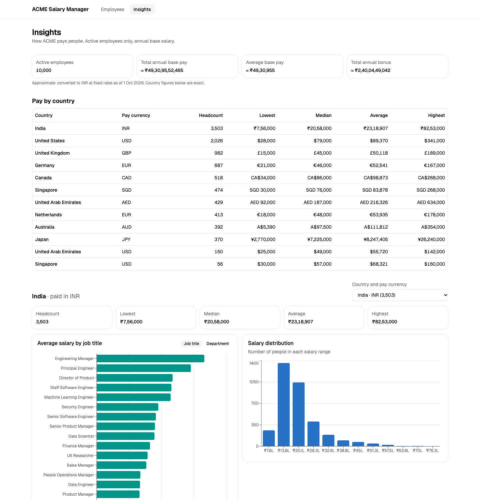

# ACME Salary Manager

A web app for ACME's HR team to manage salaries for ~10,000 employees across 10 countries,
replacing a spreadsheet, and to answer "how do we pay people?" in seconds.

**Live demo:** https://acme-salary-manager-2kmr.vercel.app · API docs (Swagger): https://acme-salary-manager-rosy.vercel.app/docs
Synthetic data, no login (see [Requirements](docs/REQUIREMENTS.md#out-of-scope-and-why)). Hosted on Vercel's free tier
with Neon Postgres, so the first request after a quiet spell can take a few seconds while things wake up.

| Employees | Insights |
|---|---|
|  |  |

## What it does

- **Employees:** search by name or email, filter by country / department / job title / status,
  sort any column, page through 10k rows. Add and edit employees with validation that matches
  the server, and remove them (soft delete) after a confirmation.
- **Insights:** org-wide headcount and pay in INR (clearly marked approximate), a pay-by-country
  table, and per-market min / median / average / max with charts by job title or department
  and the salary distribution.
- **Multi-currency done carefully:** money is stored as integer minor units in each employee's
  pay currency. Per-country statistics stay exact and in local currency, and are split by pay
  currency where a country pays in more than one. Only the org-wide summary is converted,
  using fixed, dated exchange rates.

## Run it locally (3 commands)

Prerequisites: [uv](https://docs.astral.sh/uv/) (installs Python 3.12 for you), Node 24 and pnpm.

```sh
make setup   # install backend + frontend dependencies, create the SQLite schema
make seed    # 10,000 deterministic employees in ~1 s
make dev     # API on :8000, UI on http://localhost:5173
```

Ports already in use? `make dev BACKEND_PORT=8100 FRONTEND_PORT=5180`.
Or run everything in one container: see [Deployment](docs/DEPLOYMENT.md#docker).

## Tests and checks

```sh
make test    # pytest (90 tests) + Vitest (55 tests)
make lint    # ruff, mypy --strict, ESLint, Prettier, tsc
```

The backend suite runs on in-memory SQLite by default. Set `TEST_DATABASE_URL` to run the same
suite on Postgres. CI does both, and also builds and smoke-tests the Docker image.

## Project structure

```
backend/                  FastAPI · SQLAlchemy 2 · Pydantic v2 · Alembic
  app/api/                routers: HTTP only (parse, validate, map errors)
  app/services/           use cases: employees, insights
  app/repositories/       every SQL query lives here
  app/domain/             pure rules: validation, statistics, money; no DB, no HTTP
  app/reference.py        countries, currencies + rates, department → job titles
  app/seed/               deterministic generator + idempotent bulk loader
  alembic/                migrations (the exchange-rate set is versioned here)
  tests/                  unit tests for domain logic, service tests, API tests
frontend/                 React 19 · TypeScript · Vite · TanStack Query · Tailwind + shadcn/ui · Recharts
  src/api/                typed client, types, query hooks
  src/features/           employees/ and insights/ pages and their components
  src/lib/                money formatting/parsing, small hooks
docs/                     requirements, architecture, performance, deployment, AI usage, trade-offs
```

## Documentation

- [Requirements](docs/REQUIREMENTS.md): persona, user stories, scope and what's out of scope
- [Architecture](docs/ARCHITECTURE.md): diagrams, data model, API, decision records
- [Performance](docs/PERFORMANCE.md): measured seed and API timings, index before/after
- [Deployment](docs/DEPLOYMENT.md): Vercel + Neon, and Docker
- [Trade-offs & next steps](docs/TRADEOFFS.md)
- [AI usage log](docs/AI_USAGE.md): how AI was used, what was accepted and corrected
