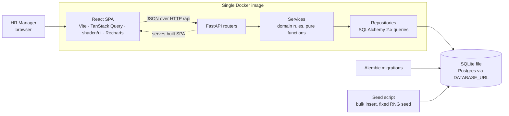
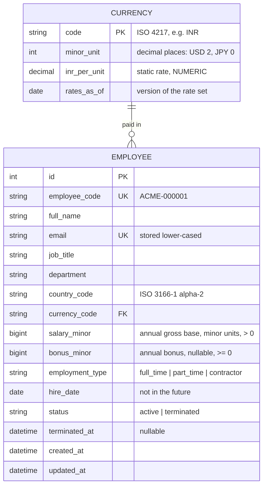

# Architecture

## System overview

One deployable process: FastAPI serves both `/api/*` and the built SPA. There is one origin, no
CORS in production, and one thing to deploy. In development, Vite runs separately and proxies `/api`.

## Data model

Countries are not a table. ISO 3166 codes are validated in the domain layer and display names
come from a static map. A table would add a join to every list query for no behavior.

## API

All responses are JSON. Errors use one envelope: `{"error": {"code": "...", "message": "...", "fields": {...}}}`.

| Method | Path | Purpose | Success | Errors |
|---|---|---|---|---|
| GET | `/api/health` | liveness + DB check | 200 | 503 |
| GET | `/api/employees` | list: `page`, `page_size` (≤100), `sort`, `order`, `country`, `department`, `job_title`, `q`, `status` (`active` default \| `terminated` \| `all`) | 200 `{items, total, page, page_size}` | 422 |
| GET | `/api/employees/{id}` | one employee | 200 | 404 |
| POST | `/api/employees` | create | 201 | 409 duplicate email/code, 422 |
| PATCH | `/api/employees/{id}` | partial update | 200 | 404, 409, 422 |
| DELETE | `/api/employees/{id}` | soft delete (mark terminated) | 204 | 404 |
| GET | `/api/reference` | countries, currencies, departments, job titles (for forms & filters) | 200 | |
| GET | `/api/insights/countries` | per country: headcount, min, max, avg, median (native currency) | 200 | |
| GET | `/api/insights/countries/{cc}/breakdown?by=job_title\|department` | avg / min / max / headcount per group | 200 | 404, 422 |
| GET | `/api/insights/countries/{cc}/distribution?buckets=10` | histogram buckets | 200 | 404, 422 |
| GET | `/api/insights/summary` | org-wide headcount, total base + bonus and averages in INR, `approximate: true`, `rates_as_of` | 200 | |

Money goes over the wire as `{"amount_minor": 8500000, "currency": "INR"}`. The client formats it
with `Intl.NumberFormat`, so the API never sends a float.

## Key decisions (ADR-lite)

### ADR-1: Money as integer minor units
- **Context:** Salaries must add up exactly. Floats can't represent `0.10`, and currencies have
  different numbers of decimals (JPY 0, USD 2, KWD 3).
- **Decision:** Store `salary_minor BIGINT` plus `currency_code`, and keep each currency's
  `minor_unit` in the `currency` table. Domain code uses a small `Money` value object (int plus
  currency). The API takes and returns minor units.
- **Trade-off:** Converting between minor and major units must be explicit in the UI and seed.
  This is a small cost for exact sums, and the logic lives in one tested function on each side.

### ADR-2: Multiple currencies with static, dated FX rates
- **Context:** HR compares pay *within* a country in its own currency, and leadership wants
  *org-wide* totals, which needs conversion. ACME reports in INR.
- **Decision:** Per-country insights are always in the native currency, so they need no
  conversion and are exact. Org-wide figures convert to INR using a static rate set
  (`inr_per_unit`, `rates_as_of`) that ships as a versioned data file and is loaded into the
  `currency` table. The response carries `approximate: true` and `rates_as_of`, and the UI says so.
- **Trade-off / limitation:** Rates go stale, and there is only one rate set at a time, so no
  historical conversion. Converting in SQL multiplies by `NUMERIC`, which SQLite stores as REAL.
  The result is rounded to whole rupees and labelled approximate, so exactness is not claimed there
  (unlike ADR-1). Live rates can come later behind the same `currency` table.

### ADR-3: Aggregations in SQL, portable SQL only
- **Context:** Loading 10k rows into Python to compute statistics doesn't scale and wastes memory.
- **Decision:** `MIN/MAX/AVG/COUNT/SUM` use `GROUP BY`. **Median** uses window functions
  (`ROW_NUMBER() OVER (PARTITION BY … ORDER BY salary_minor)` + `COUNT`), which work on SQLite
  ≥ 3.25 and Postgres alike. **Distribution** buckets are computed in SQL with integer arithmetic
  over `(salary - min) * n / (max - min + 1)`. AVG is rounded to an integer minor unit.
- **Trade-off:** The median query is more complex than `percentile_cont` (which is Postgres-only).
  We accept it to keep one code path for both databases, and pin it with hand-computed tests.

### ADR-4: Offset pagination
- **Context:** 10k rows. HR expects page numbers and a total ("page 3 of 200").
- **Decision:** `LIMIT/OFFSET` with a `COUNT(*)` for the same filter. `page_size` is capped at 100.
  Sorting is restricted to an allow-list of columns, with `id` as a tie-breaker for stable pages.
- **Trade-off:** Deep offsets get slower, and rows can shift between pages while someone edits.
  At 10k rows both are negligible. Keyset pagination would remove them but takes away jump-to-page.

### ADR-5: Indexes driven by measured query patterns
- **Context:** We know the access patterns: filter by country / department / job title, group by
  country (+ job title / department), sort by salary or name, and look up email / code.
- **Decision:** Start with the unique indexes (email, employee_code) only. In Phase 6 add
  composite indexes such as `(country_code, job_title)`, `(country_code, department)` and
  `(country_code, salary_minor)`, but only where `EXPLAIN QUERY PLAN` and timings show a win.
  Record before/after numbers in `PERFORMANCE.md`.
- **Trade-off:** Text search uses `LIKE '%q%'`, which can't use a B-tree index. A full scan of 10k
  rows is about a millisecond. FTS5 / `pg_trgm` is noted as the path if data grows by 100×.

### ADR-6: Layering — routers → services → repositories
- **Context:** Reviewers will read the tests. Domain rules should be testable without HTTP or a DB.
- **Decision:** Routers only parse and validate the request (Pydantic) and map errors to HTTP.
  Services hold the rules: uniqueness, salary bounds, ISO validation, money and statistics shaping,
  all written as pure functions where possible. Repositories own every SQLAlchemy query.
  Domain errors (`EmployeeNotFound`, `DuplicateEmail`) are plain exceptions that one handler maps
  to 404 / 409.
- **Trade-off:** There are more files than one fat route module would need. No generic repository
  base class or DI container: plain functions and a FastAPI `Depends` for the session.

### ADR-7: SQLite by default, Postgres-ready by config
- **Decision:** `DATABASE_URL` env var. SQLite file locally and in tests (in-memory, recreated per
  test). Alembic migrations use `render_as_batch` so SQLite `ALTER`s work.
  No SQLite-only SQL in the repositories.
- **Trade-off:** SQLite has one writer at a time, which is fine for an HR tool with a few users.

### ADR-8: UI styling — Tailwind CSS (+ shadcn/ui components, TanStack Table)
- **Context:** The core of the app is a server-paginated table, a form dialog, and charts.
- **Decision:** Tailwind CSS for styling. Accessible primitives (dialog, select, alert-dialog)
  come from shadcn/ui, which is Tailwind + Radix copied into the repo rather than a runtime
  dependency. TanStack Table provides headless table state, wired to server-side pagination
  and sort. Recharts for charts.
- **Trade-off vs MUI:** MUI's DataGrid gives more for free, but the server-mode features we'd
  rely on are partly in paid tiers, the bundle is heavier, and the styling is harder to make
  look intentional. With Tailwind we own the component code: a little more setup, but a smaller
  bundle and easier review.

### ADR-9: Deployment as a single Docker image
- **Decision:** A multi-stage Dockerfile builds the SPA with Node, then copies `dist/` into a slim
  Python 3.12 image that runs `alembic upgrade head`, the idempotent seed, then `uvicorn`.
  It is deployable to Render / Fly.io / Railway as-is.
- **Trade-off:** On free tiers, SQLite on an ephemeral disk resets on redeploy. That is
  acceptable for a demo of synthetic data because the seed restores it. For real use, point
  `DATABASE_URL` at managed Postgres (no code change).

### ADR-10: Soft delete via a status column
- **Context:** HR "removes" leavers, but losing their record entirely is rarely what an HR team
  wants.
- **Decision:** `DELETE` sets `status = 'terminated'` and `terminated_at`. Every list and
  insights query filters `status = 'active'` unless asked otherwise, and the repositories apply
  that default in one place so it can't be forgotten per query. Email and employee code stay
  unique across all rows, including terminated ones.
- **Trade-off:** Every query carries the status predicate (and future indexes lead with it where
  it helps). A rehire needs a restore action, which is out of scope for now.
